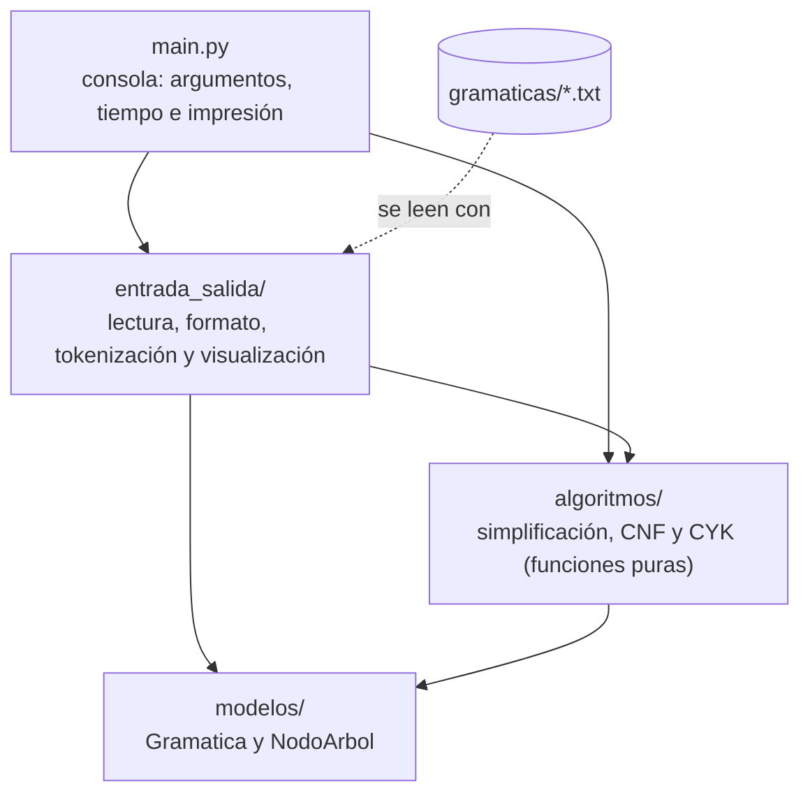
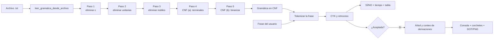
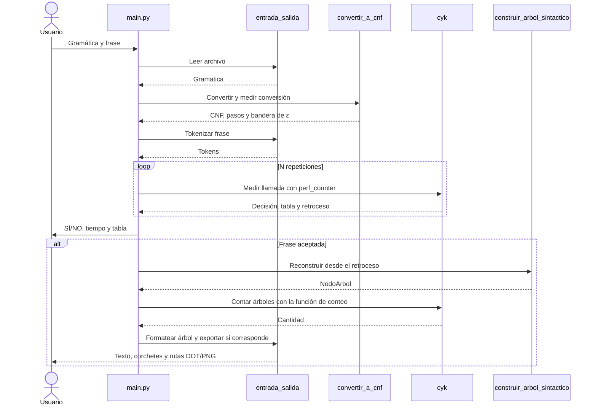
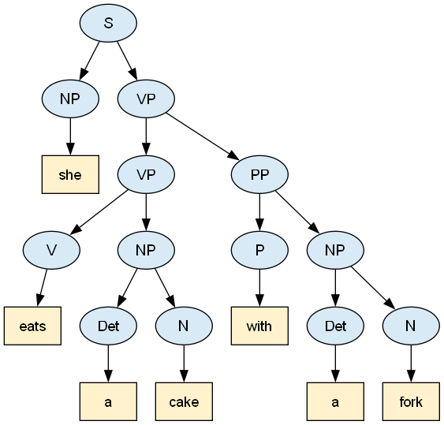
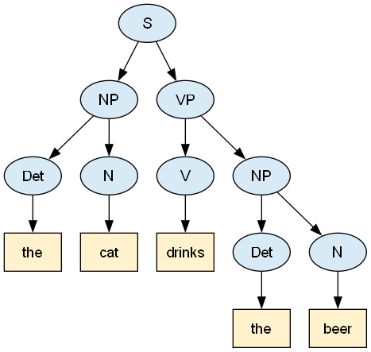
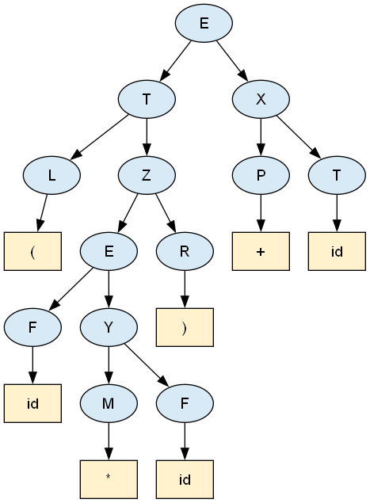

# Proyecto 2 — Simplificación de gramáticas y algoritmo CYK

**Curso:** Teoría de la Computación

**Integrantes:**

- Lázaro Díaz — carnet 24713
- Jorge Villeda — carnet 24932

---

## 1. Diseño de la aplicación

La aplicación es un programa de consola en **Python 3.10+** que usa solo la biblioteca estándar. Recibe una gramática libre de contexto desde un archivo `.txt` (puede estar o no en Forma Normal de Chomsky), la simplifica, la convierte a **CNF** mostrando cada paso y después usa el algoritmo **CYK** para validar frases.

El método de modelado es **por capas**: los algoritmos están separados de todo lo que lee, escribe o imprime. Así cada algoritmo queda "en su forma de libro" y se puede probar por separado.

### 1.1 Arquitectura



Las dependencias van en una sola dirección: `main.py` → `entrada_salida/` → `algoritmos/` → `modelos/`. Ningún módulo de `algoritmos/` o `modelos/` imprime, pide datos ni toca archivos.

| Módulo | Responsabilidad |
|---|---|
| `modelos/gramatica.py` | Clase `Gramatica`: variables, producciones ordenadas, terminales, copia e igualdad. |
| `entrada_salida/lector_gramatica.py` | Convierte un `.txt` en `Gramatica` y reporta errores de formato con su número de línea. |
| `entrada_salida/escritor_gramatica.py` | Convierte una `Gramatica` en texto (mismo formato de entrada), la resume y la guarda. |
| `algoritmos/eliminar_epsilon.py` | Paso 1: símbolos anulables y eliminación de producciones ε. |
| `algoritmos/eliminar_unitarias.py` | Paso 2: parejas unitarias y eliminación de producciones unitarias. |
| `algoritmos/eliminar_inutiles.py` | Paso 3: símbolos generadores, alcanzables y eliminación de inútiles. |
| `algoritmos/forma_normal_chomsky.py` | Validación de CNF, pasos 4 y 5 (construcciones (a) y (b)) y la conversión completa `convertir_a_cnf`. |
| `entrada_salida/formato_pasos.py` | Texto del paso a paso de la conversión (como el ejemplo del catedrático). |
| `main.py` | Argumentos de la consola, medición del tiempo, impresión y manejo de errores. |
| `entrada_salida/tokenizador.py` | Normaliza y segmenta la frase según el vocabulario. |
| `algoritmos/cyk.py` | Reconoce, guarda retrocesos, reconstruye el árbol y cuenta derivaciones. |
| `modelos/nodo_arbol.py` | Símbolo e hijos ordenados; hojas, altura y cantidad de nodos. |
| `entrada_salida/formato_cyk.py` | Tabla triangular, decisión y tiempos. |
| `entrada_salida/visualizacion_arbol.py` | Árbol en texto, corchetes, DOT e imagen con Graphviz. |

### 1.2 Flujo general



Cada paso devuelve una gramática **nueva** (nunca se modifica la anterior), por lo que el programa puede mostrar todas las gramáticas intermedias.

### 1.3 Modelo de datos

La clase `Gramatica` representa G = (V, T, P, S):

- `simbolo_inicial`: la variable S. Siempre es la primera variable.
- `producciones`: diccionario `variable -> lista de cuerpos`. Un cuerpo es una tupla de símbolos (`Cuerpo = tuple[str, ...]`) y **ε se representa con la tupla vacía `()`**. Tanto las variables como los cuerpos conservan su orden de inserción y no se repiten.
- `variables`: las claves del diccionario. Una variable puede tener la lista vacía (por ejemplo `B` en `S -> A B | a`).
- `terminales`: se calculan en lugar de guardarse; son los símbolos de los cuerpos que no son variables, en orden de primera aparición.
- `copiar()` devuelve una copia independiente y `==` compara el símbolo inicial y las producciones sin importar el orden.

Conservar el orden de inserción hace que la salida sea **determinista**. En particular, permite que la CNF de `1.txt` salga en el mismo orden que el archivo `1-cnf.txt` del catedrático.

### 1.4 Formato de los archivos de gramática

- Una producción por línea: `CABEZA -> cuerpo1 | cuerpo2` (también se acepta `→`).
- Los símbolos se separan con espacios; un terminal puede tener varias letras (`id`, `cooks`).
- `e` o `ε` representan la cadena vacía.
- **Variable**: todo símbolo que aparece como cabeza o que empieza con mayúscula. **Terminal**: todo lo demás.
- El símbolo inicial es la cabeza de la primera línea; una cabeza repetida junta sus producciones.
- Las líneas vacías y las que empiezan con `#` se ignoran.
- Los errores (línea sin flecha, cabeza vacía o con espacios, alternativa vacía, `e` mezclado con otros símbolos, etc.) se reportan con su número de línea.

### 1.5 Algoritmos de simplificación y conversión a CNF

Se sigue el orden de Hopcroft, que es el mismo del ejemplo del catedrático: **ε → unitarias → inútiles → CNF (a) → CNF (b)**. El orden importa porque eliminar ε puede crear producciones unitarias, y eliminar unitarias puede dejar símbolos inútiles.

En las complejidades, |V| es la cantidad de variables y |G| la suma de las longitudes de todos los cuerpos.

#### 1.5.1 Paso 1 — Símbolos anulables y producciones ε (`eliminar_epsilon.py`)

Una variable A es **anulable** si A ⇒* ε. Se calcula con un punto fijo:

```text
anulables ← ∅
repetir
    para cada variable A que no es anulable:
        si A tiene un cuerpo cuyos símbolos son todos anulables (incluye el cuerpo vacío):
            agregar A a anulables
hasta que anulables no cambie
```

Después, cada producción `A -> X1 … Xk` con `m` anulables se reemplaza por sus **2^m versiones** (cada anulable presente o ausente), sin la versión vacía y sin repetidos. Las combinaciones se generan con `itertools.product([True, False], repeat=m)`, así que el cuerpo completo siempre va primero. El resultado cumple **L(G1) = L(G) − {ε}**.

- Complejidad: O(|V|·|G|) para los anulables; en el peor caso, 2^m versiones por producción.
- Ejemplo del libro: `S -> A B`, `A -> a A A | ε`, `B -> b B B | ε` queda en `S -> A B | A | B`, `A -> a A A | a A | a` y `B -> b B B | b B | b`.

#### 1.5.2 Paso 2 — Parejas unitarias y producciones unitarias (`eliminar_unitarias.py`)

`(A, B)` es una **pareja unitaria** si A ⇒* B usando solo producciones `A -> B`. Para cada variable se hace un recorrido en anchura (BFS) que sigue solo producciones unitarias:

```text
para cada variable A:
    alcanzadas ← [A]                      # base: (A, A)
    mientras haya variables pendientes B:
        para cada producción unitaria B -> C:
            si C no está en alcanzadas: agregar C   # inducción: (A, C)
nueva gramática: para cada pareja (A, B), agregar a A los cuerpos NO unitarios de B
```

- Complejidad: O(|V|·|G|) para las parejas, y O(|parejas|·|G|) para la nueva gramática.
- Los ciclos (`A -> B`, `B -> A`) no causan recursión infinita, porque cada variable se visita una sola vez.

#### 1.5.3 Paso 3 — Símbolos inútiles (`eliminar_inutiles.py`)

Un símbolo es útil si es **generador** (deriva una cadena de terminales) y **alcanzable** (aparece en alguna derivación desde S).

```text
generadores ← terminales
repetir: agregar toda variable con un cuerpo formado solo por generadores
quitar las variables NO generadoras y todo cuerpo que las use
alcanzables ← BFS desde S por los cuerpos
quitar las variables NO alcanzables
```

- **Primero los no generadores y después los no alcanzables.** En `S -> A B | a`, `A -> b`, quitar `B` (no generador) elimina `S -> A B` y deja `A` inalcanzable. Si se hiciera al revés, `A -> b` sobreviviría; esto está cubierto por una prueba.
- El símbolo inicial siempre se conserva, aunque se quede sin producciones (lenguaje vacío), para que el programa no falle.
- Complejidad: O(|V|·|G|).

#### 1.5.4 Paso 4 — CNF (a): terminales en cuerpos largos (`forma_normal_chomsky.py`)

Cada terminal que aparece en un cuerpo de longitud ≥ 2 se reemplaza por una variable nueva con una sola producción (`P -> +`). El mismo terminal siempre usa la misma variable, y los cuerpos de un solo terminal no se tocan. Complejidad: O(|G|).

**Nombres de las variables nuevas.** Se usan los nombres del libro: `( → L`, `) → R`, `+ → P`, `* → M`, `0 → Z`, `1 → O`. Si el terminal empieza con letra, se usa esa letra en mayúscula (`a → A`). Si el nombre ya existe, se toma la primera letra libre de la `Z` hacia la `A`, y si no queda ninguna, `C1`, `C2`, … Un nombre nuevo nunca choca con una variable ni con un terminal.

#### 1.5.5 Paso 5 — CNF (b): binarización (`forma_normal_chomsky.py`)

Una producción `A -> B1 B2 … Bk` con k ≥ 3 se reemplaza por `A -> B1 V`, donde `V` es la variable del sufijo `B2 … Bk`:

```text
variable_del_sufijo(B2 … Bk):
    si el sufijo ya tiene variable: reutilizarla
    si no: crear V (primera letra libre desde la Z)
           V -> B2 B3                      si el sufijo mide 2
           V -> B2 variable_del_sufijo(B3 … Bk)   si mide más
```

**Se reutiliza la misma variable para el mismo sufijo**, igual que en el ejemplo del catedrático: `C1 -> E R` sirve a `E`, `T` y `F`. Complejidad: O(|G|).

#### 1.5.6 `convertir_a_cnf`: la conversión completa

`convertir_a_cnf` aplica los 5 pasos y devuelve un `ResultadoConversionCNF` con:

- `pasos`: un `PasoConversion` por paso, con su título, la gramática que dejó y sus detalles (anulables, parejas unitarias, símbolos eliminados y variables nuevas). Con esto se arma el paso a paso.
- `gramatica_cnf`: la gramática final. Sus variables van en este orden: primero las originales que quedaron, luego las del paso (b) y al final las del paso (a). **Con ese orden, la salida de `1.txt` es idéntica, línea por línea, a `1-cnf.txt`.**
- `genera_cadena_vacia`: una gramática en CNF no puede generar ε, así que, si el símbolo inicial era anulable en la gramática original, se guarda este indicador para que CYK acepte la frase vacía por separado. No se agrega un símbolo inicial nuevo (como en Hopcroft).
- `ya_estaba_en_cnf`: indica si la gramática de entrada ya cumplía la CNF. Es el caso de la gramática del inglés del enunciado: la conversión no le cambia nada y cada paso aparece como "(sin cambios)".

### 1.6 Ejemplo paso a paso con `1.txt`

Salida real de `python main.py -g gramaticas/1.txt`:

```text
Gramática: gramaticas\1.txt

══ GRAMÁTICA ORIGINAL ══
E -> T X
X -> + T X | ε
T -> F Y
Y -> * F Y | ε
F -> ( E ) | id
Símbolo inicial: E | Variables (5): E, X, T, Y, F | Terminales (5): +, *, (, ), id | Producciones: 8

── Paso 1: Eliminar producciones ε ──
Anulables: X, Y
E -> T X | T
X -> + T X | + T
T -> F Y | F
Y -> * F Y | * F
F -> ( E ) | id

── Paso 2: Eliminar producciones unitarias ──
Parejas unitarias: (E, E), (E, T), (E, F), (X, X), (T, T), (T, F), (Y, Y), (F, F)
E -> T X | F Y | ( E ) | id
X -> + T X | + T
T -> F Y | ( E ) | id
Y -> * F Y | * F
F -> ( E ) | id

── Paso 3: Eliminar símbolos inútiles ──
No generadores: ninguno
No alcanzables: ninguno
(sin cambios)

── Paso 4: CNF (a): reemplazar terminales en cuerpos largos ──
Variables nuevas: L -> (, R -> ), P -> +, M -> *
E -> T X | F Y | L E R | id
X -> P T X | P T
T -> F Y | L E R | id
Y -> M F Y | M F
F -> L E R | id
L -> (
R -> )
P -> +
M -> *

── Paso 5: CNF (b): binarizar cuerpos largos ──
Variables nuevas: Z -> E R, W -> T X, V -> F Y
E -> T X | F Y | L Z | id
X -> P W | P T
T -> F Y | L Z | id
Y -> M V | M F
F -> L Z | id
Z -> E R
W -> T X
V -> F Y
L -> (
R -> )
P -> +
M -> *

══ GRAMÁTICA EN CNF ══
E -> T X | F Y | L Z | id
X -> P W | P T
T -> F Y | L Z | id
Y -> M V | M F
F -> L Z | id
Z -> E R
W -> T X
V -> F Y
L -> (
R -> )
P -> +
M -> *
Símbolo inicial: E | Variables (12): E, X, T, Y, F, Z, W, V, L, R, P, M | Terminales (5): id, (, ), +, * | Producciones: 20

Tiempo de conversión a CNF: 0.2546 ms
```

Los anulables, las parejas unitarias y las variables nuevas coinciden con el PDF del catedrático (allí `E'` y `T'` se llaman `X` y `Y`, y `C1`, `C2`, `C3` se llaman `Z`, `W`, `V`). Además, la CNF exportada es **idéntica** al archivo del catedrático:

```text
> python main.py -g gramaticas/1.txt --sin-pasos --guardar-cnf salidas/1-cnf.txt
> diff salidas/1-cnf.txt gramaticas/1-cnf.txt
(sin diferencias)
```

Esto también lo verifica automáticamente la prueba `test_gramatica_uno_da_exactamente_1_cnf` (`pruebas/test_forma_normal_chomsky.py`).

### 1.7 Tokenización de la frase

`tokenizar_frase` procesa los fragmentos separados por espacios. Primero busca
el fragmento completo como terminal, tanto tal cual como en minúsculas. Si no
lo encuentra y contiene símbolos no alfanuméricos, o todos los terminales son
de un carácter, intenta segmentarlo por completo usando programación dinámica.
Prueba primero los terminales más largos, pero conserva una solución para cada
sufijo: una elección larga que deja un sufijo imposible no impide encontrar otra.

Si sigue sin reconocerlo, quita puntuación de los extremos y repite esas dos
operaciones. Un fragmento vacío se ignora; uno desconocido se conserva en
minúsculas. `encontrar_tokens_desconocidos` informa esas palabras sin duplicados.
Así `The cat drinks the beer.` se normaliza, `(id*id)+id` se segmenta y `aabb`
se convierte en cuatro tokens en la gramática aⁿbⁿ. Una palabra alfanumérica
como `athe` o `idid` no se divide cuando hay terminales largos: evita aceptar
errores ortográficos como una concatenación accidental de palabras válidas.

### 1.8 Algoritmo CYK

La programación dinámica guarda soluciones de subproblemas solapados para
reutilizarlas. Aquí se resuelve pertenencia, no una optimización numérica:
la propiedad de descomposición que cumple el papel de subestructura óptima
consiste en que una derivación `A -> B C` existe exactamente cuando existen
las dos subderivaciones correspondientes a algún corte.

`X[inicio][fin]` es el conjunto de variables que derivan los tokens del intervalo
inclusivo. La base agrega A cuando existe `A -> tokens[posicion]`. Para cada
longitud mayor, se consideran todos los cortes y producciones binarias:

```text
X[posicion][posicion] = {A : A -> tokens[posicion]}
para longitud = 2 hasta cantidad_tokens:
    para inicio = 0 hasta cantidad_tokens - longitud:
        fin = inicio + longitud - 1
        para corte = inicio hasta fin - 1:
            para cada A -> B C en orden de la gramática:
                si B pertenece a X[inicio][corte] y C a X[corte + 1][fin]:
                    agregar A a X[inicio][fin]
acepta = simbolo_inicial pertenece a X[0][cantidad_tokens - 1]
```

El orden por longitud garantiza que ambas subcadenas ya están resueltas. Con
n tokens, |R| producciones y |V| variables, el tiempo es O(n³·|R|) y la memoria
de la tabla y el retroceso es O(n²·|V|). Las producciones se clasifican una vez
por llamada. La validación de CNF ocurre antes del caso vacío y rechaza con
`ValueError` cualquier gramática sin convertir. Con cero tokens la tabla es
vacía y la decisión viene de `genera_cadena_vacia`.

Tabla real para `She eats a cake with a fork`:

```text
Tabla CYK (fila = longitud de la subcadena, columna = posición inicial):
7 │ {S}
6 │ ∅        {VP}
5 │ ∅        ∅        ∅
4 │ {S}      ∅        ∅        ∅
3 │ ∅        {VP}     ∅        ∅        {PP}
2 │ {S}      ∅        {NP}     ∅        ∅        {NP}
1 │ {NP}     {VP, V}  {Det}    {N}      {P}      {Det}    {N}
  │ she      eats     a        cake     with     a        fork
```

La celda superior contiene S, por lo que la frase pertenece al lenguaje.

### 1.9 Construcción del parse tree

`ResultadoCYK.retroceso` extiende la tabla guardando la procedencia de cada
variable. Su clave es `(inicio, fin, variable)`; el valor es un token para una
producción terminal, o `(corte, izquierda, derecha)` para una binaria. Se usa
`setdefault` para conservar la primera derivación encontrada, recorriendo
los cortes y las producciones en un orden fijo.

En el ejemplo, `retroceso[(0, 6, "S")] = (0, "NP", "VP")`: la raíz S tiene
un NP que cubre `she` y un VP que cubre las seis palabras restantes.
`construir_arbol_sintactico` sigue estas referencias recursivamente y crea
`NodoArbol`. Una frase rechazada devuelve `None`. Para ε aceptada crea
`NodoArbol("S", [NodoArbol("ε")])`; esa hoja representa la cadena de cero tokens.
En frases no vacías, las hojas coinciden con los tokens de izquierda a derecha.
La altura de una hoja es cero; el árbol de `he cooks` tiene cinco nodos y altura dos.

El árbol corresponde a la **gramática en CNF**. Las variables auxiliares de
la conversión aparecen explícitamente, como L, R y Z en las expresiones.

### 1.10 Medición del tiempo

`main.py` llama a `time.perf_counter()` inmediatamente antes y después de
`cyk()`. Este reloj mide intervalos con alta resolución. Se incluyen la
validación de CNF, los precálculos, la tabla y el retroceso que realiza esa
llamada; se excluyen lectura, conversión, tokenización, conteo de árboles,
reconstrucción, impresión y Graphviz. El tiempo de conversión se informa aparte.

Con `--repeticiones N` se repite CYK N veces, se calcula el promedio y se informa
también el mínimo. Una frase corta tarda muy poco y una sola medición es
sensible a la planificación del sistema. Los tiempos se muestran en
milisegundos con cuatro decimales; N debe ser un entero mayor o igual a uno.

### 1.11 Conteo de árboles y ambigüedad

`contar_arboles_de_derivacion` usa otra tabla, donde cada celda asocia una
variable con su cantidad de árboles. La base cuenta producciones terminales;
para cada `A -> B C` y cada corte suma el producto de los conteos izquierdo y
derecho. Las alternativas se suman porque son árboles diferentes; las ramas
se multiplican porque sus elecciones son independientes.

Más de un árbol demuestra ambigüedad de esa frase en la CNF. El programa muestra
el conteo y conserva el primer árbol para visualizarlo. No se almacenan todos
los árboles. El conteo es sobre la CNF: la simplificación puede fusionar
derivaciones de la gramática original. Para ε se usa la convención 1 si se
acepta y 0 si se rechaza, sin contar posibles ciclos de derivación vacía.
El número de operaciones sigue O(n³·|R|), aunque el coste de operar enteros
crece con la cantidad de dígitos cuando hay muchos árboles.

### 1.12 Visualización

`arbol_a_texto` dibuja ramas con `├──` y `└──`; `arbol_a_corchetes` produce una
representación compacta. `arbol_a_dot` asigna identificadores en preorden,
escapa etiquetas y usa `ordering="out"` para conservar el orden de los hijos.
Los nodos internos son elipses y las hojas son cajas de distinto color.

`exportar_arbol_imagen` siempre guarda el `.dot` y ejecuta Graphviz cuando
`buscar_ejecutable_dot` lo encuentra en PATH o en las rutas comunes de Windows.
Sin Graphviz se conserva DOT y se informa su ruta. `--sin-imagen` omite ambos
archivos; `--salida CARPETA` permite elegir dónde guardarlos.

### 1.13 Secuencia para una frase



## 2. Discusión

### 2.1 Obstáculos y decisiones

**Orden de simplificación.** Eliminar ε puede introducir producciones unitarias;
eliminar unitarias puede dejar variables inútiles. Por eso se aplica ε →
unitarias → inútiles antes de convertir a CNF. Dentro del tercer paso se quitan
primero los no generadores: al borrar sus producciones pueden quedar símbolos
inalcanzables que no se habrían detectado si se hiciera al revés.

**Coincidencia exacta con `1-cnf.txt`.** No basta con reconocer el mismo lenguaje
si se quiere reproducir el ejemplo del catedrático. Se fijaron nombres
mnemotécnicos para terminales, nombres libres desde Z para binarización,
reutilización de sufijos y orden final de variables. Una prueba compara el
texto completo, además de las pruebas de equivalencia de reconocimiento.

**Cadena vacía.** La variante estricta de CNF usada aquí excluye ε. Se calcula
si el inicial era anulable antes de eliminar producciones vacías y se transporta
esa información mediante `genera_cadena_vacia`. Así `anbn.txt` acepta ε aunque
su CNF no tenga un cuerpo vacío. El archivo de CNF exportado no almacena la
bandera: al cargarlo de nuevo por sí solo no recupera la aceptación de ε.

**Inglés ya en CNF.** La gramática principal no necesita transformaciones, pero
se muestran los cinco pasos y se señalan como sin cambios. La gramática de
expresiones permite demostrar las transformaciones que sí exige el proyecto.

**Tokenización.** Separar únicamente por espacios no resuelve `(id*id)+id`;
segmentar cualquier palabra aceptaría accidentalmente `athe` como `a the`.
Se combinan reconocimiento completo, segmentación condicionada y limpieza
de puntuación. `The cat drinks the beer.` conserva su significado sintáctico
tras normalizar mayúsculas y punto final.

**Sintaxis, semántica y ambigüedad.** `the fork eats the cat` pertenece al lenguaje
aunque describa algo absurdo. CYK solo verifica las producciones. Por otra
parte, una frase puede tener varias estructuras válidas: `id+id*id` tiene dos
árboles en `ambigua.txt`. El conteo informa esa diferencia y el retroceso
determinista elige una estructura para mostrar.

**Árbol sobre CNF.** La conversión introduce variables como Z, L y R. Se muestran
porque son parte de las producciones usadas por CYK; reconstruir la gramática
original requeriría guardar la procedencia de cada transformación.

**Determinismo y UTF-8.** Las celdas de CYK son conjuntos, pero el retroceso se
decide recorriendo producciones ordenadas y las celdas se imprimen en el orden
de las variables. En Windows se configura UTF-8 para mostrar ε y las ramas del
árbol, se leen archivos con soporte para BOM y se captura la salida de las
pruebas con codificación explícita.

**Graphviz en Windows.** El ejecutable puede estar instalado sin aparecer en
PATH. Se comprueba también `Program Files` y `Program Files (x86)`. En la
validación se utilizó la instalación disponible y se generaron los tres PNG
del reporte. Una prueba simula su ausencia y verifica que se conserve DOT;
el reconocimiento y el árbol en texto funcionan sin esa herramienta.

**Recursión por la izquierda.** CYK combina intervalos de longitud creciente,
por lo que no necesita eliminarla. `expresiones_recursiva.txt` y `VP -> VP PP`
se manejan sin un descenso recursivo sobre producciones. La transformación de
recursión izquierda del PDF explica el origen de `1.txt`, pero no constituye
otro paso requerido por nuestra conversión a CNF.

### 2.2 Recomendaciones

Conviene definir primero la representación de ε y el criterio para distinguir
variables de terminales. Los ejemplos de cada paso deben probarse por separado
antes de conectarlos con CYK. Conservar las gramáticas intermedias permite
localizar el paso que introduce una diferencia.

Además de probar frases conocidas, es útil comparar contra un reconocedor que
no reutilice el mismo algoritmo. Las enumeraciones de este proyecto detectan
aceptaciones y rechazos erróneos; las derivaciones aleatorias comprueban cadenas
más variadas. Las semillas fijas permiten reproducir cualquier fallo.

Para evaluar rendimiento, debe medirse solo el algoritmo y repetir la llamada;
la impresión o Graphviz podrían dominar el tiempo total. Para entregar, se debe
probar tanto el modo interactivo como `-f`, comprobar los mensajes de error y
verificar los enlaces e imágenes de la documentación.

### 2.3 Limitaciones y posibles mejoras

El árbol y el conteo corresponden a la CNF. Una mejora sería conservar metadatos
de las transformaciones para reconstruir árboles de la gramática original.
También se podrían comparar otros reconocedores, como Earley, que permiten
trabajar directamente con una CFG.

Un bosque sintáctico compartido permitiría explorar todos los árboles de una
frase ambigua sin materializarlos inmediatamente. Una interfaz gráfica podría
mostrar la construcción de cada celda y sus cortes. Para frases muy largas
habría que considerar el coste cúbico, los enteros grandes del conteo y la
profundidad recursiva de la reconstrucción y visualización. Ninguna de esas
ampliaciones es necesaria para los ejemplos de esta entrega.

### 2.4 Distribución del trabajo

| Integrante | Commits del plan | Responsabilidades |
|---|---|---|
| Lázaro Díaz — 24713 | 1–15 y 15b: 16 commits | Estructura, modelo de gramática, lectura y escritura, simplificación, CNF, consola del paso a paso y documentación de diseño. |
| Jorge Villeda — 24932 | 16–30 y 23b: 16 commits | Tokenizador, CYK, retroceso, árbol, Graphviz, tabla, consola de frases, medición del tiempo, conteo, pruebas de integración y propiedades, ejemplos, discusión y documentación final. |

### 2.5 Conclusiones

La aplicación integra la conversión de CFG a CNF con reconocimiento mediante
programación dinámica. La separación entre algoritmos y entrada/salida permite
verificar cada etapa sin depender de la consola o Graphviz. La conversión de
`1.txt` reproduce exactamente la referencia y las pruebas independientes no
encontraron diferencias en los conjuntos examinados.

Guardar el retroceso permite explicar una aceptación mediante un árbol y no
solo mediante un resultado booleano. El conteo complementa esa explicación al
detectar frases ambiguas. Los resultados se limitan a corrección sintáctica
respecto a la gramática; no pretenden evaluar el significado de una oración.

## 3. Ejemplos y pruebas realizadas

Mediciones realizadas el 19 de octubre de 2026 en Windows, con Intel Core i5-10400
CPU @ 2.90 GHz y Python 3.13.13. Cada fila corresponde a una ejecución real de
`main.py --repeticiones 1000`: se informa el promedio de las llamadas a CYK,
sin lectura, conversión, tokenización, conteo, árbol ni impresión. Los tiempos
dependen del procesador, de la versión de Python y de la carga del sistema.

Comando reproducible (cambiar gramática y frase según la tabla):

```powershell
python main.py -g gramaticas/ingles.txt -f "he cooks" --repeticiones 1000 --sin-imagen
```

### 3.1 Frases en el lenguaje

| Frase | Resultado | Tiempo CYK promedio (ms) | Comentario |
|---|---|---|---|
| `She eats a cake with a fork` | SÍ | 0.0479 | Ejemplo del enunciado: VP seguido de PP. |
| `The cat drinks the beer.` | SÍ | 0.0337 | Mayúscula y punto normalizados. |
| `he cooks` | SÍ | 0.0206 | La frase más corta. |
| `the dog eats` | SÍ | 0.0283 | Sujeto con determinante. |
| `she cuts the meat with a knife` | SÍ | 0.0482 | Complemento instrumental. |
| `he drinks the juice in the oven` | SÍ | 0.0506 | Correcta sintácticamente, extraña semánticamente. |
| `the cat cooks a soup with a spoon in the oven` | SÍ | 0.1108 | Dos PP sucesivos. |
| `a dog drinks the soup` | SÍ | 0.0342 | Verbo con objeto directo. |
| `the fork eats the cat` | SÍ | 0.0335 | Sintaxis válida aunque el significado sea absurdo. |
| `a cake eats she` | SÍ | 0.0277 | La gramática permite she como objeto. |

### 3.2 Frases fuera del lenguaje

| Frase | Resultado | Tiempo CYK promedio (ms) | Comentario |
|---|---|---|---|
| `She eats a cake with` | NO | 0.0335 | PP incompleto. |
| `cat drinks the beer` | NO | 0.0280 | Falta determinante del sujeto. |
| `the cat drinks beer` | NO | 0.0325 | Falta determinante de beer. |
| `the cat the beer` | NO | 0.0282 | Falta verbo. |
| `he she eats` | NO | 0.0246 | Dos sujetos seguidos. |
| `eats a cake` | NO | 0.0304 | Falta sujeto. |
| `she with a fork eats` | NO | 0.0366 | PP antes del verbo. |
| `the the cat eats` | NO | 0.0316 | Determinante duplicado. |
| `she eats pizza` | NO | 0.0236 | pizza no pertenece al vocabulario. |
| `she eats athe cake` | NO | 0.0294 | athe se conserva como palabra desconocida. |
| *(vacía)* | NO | 0.0178 | El inglés no genera ε. |

### 3.3 Gramática 1

| Frase | Resultado | Tiempo CYK promedio (ms) | Comentario |
|---|---|---|---|
| `(id*id)+id` | SÍ | 0.0766 | Ejemplo del catedrático. |
| `( id * id ) + id` | SÍ | 0.0752 | Mismos tokens con espacios. |
| `id` | SÍ | 0.0203 | Terminal simple. |
| `id+id` | SÍ | 0.0297 | Suma. |
| `id*id` | SÍ | 0.0326 | Producto. |
| `((id))` | SÍ | 0.0445 | Paréntesis anidados. |
| `id+id*id` | SÍ | 0.0640 | Producto dentro de suma. |
| `(id+id)*id` | SÍ | 0.0906 | Suma entre paréntesis. |
| `(id*id` | NO | 0.0340 | Falta cierre de paréntesis. |
| `id+` | NO | 0.0301 | Falta operando derecho. |
| `+id` | NO | 0.0222 | Falta operando izquierdo. |
| `id id` | NO | 0.0228 | Falta operador. |
| `()` | NO | 0.0330 | Falta expresión interior. |
| `id**id` | NO | 0.0324 | Operador duplicado. |
| *(vacía)* | NO | 0.0194 | La gramática no genera ε. |
| `idid` | NO | 0.0212 | idid es desconocido. |

La conversión de `1.txt` elimina ε y unitarias, conserva los símbolos útiles,
reemplaza terminales y binariza cuerpos. El resultado coincide exactamente con
`1-cnf.txt`; el desarrollo completo está en [§1.6](#16-ejemplo-paso-a-paso-con-1txt).

### 3.4 Parse trees

Las imágenes siguientes se generaron con Graphviz a partir del retroceso de CYK.
Las hojas mantienen el orden de los tokens; el árbol de expresiones usa la CNF.







El primer árbol en consola:

```text
S
├── NP
│   └── she
└── VP
    ├── VP
    │   ├── V
    │   │   └── eats
    │   └── NP
    │       ├── Det
    │       │   └── a
    │       └── N
    │           └── cake
    └── PP
        ├── P
        │   └── with
        └── NP
            ├── Det
            │   └── a
            └── N
                └── fork
```

### 3.5 Ambigüedad

Con `gramaticas/ambigua.txt`, `id+id*id` tiene **2** árboles: la suma puede ser
la operación de la raíz o puede serlo el producto. `id+id+id*id` tiene **5**.
La gramática no impone precedencia; el programa cuenta las derivaciones de la
CNF y muestra la primera según el orden de cortes y producciones.

```powershell
python main.py -g gramaticas/ambigua.txt -f "id+id*id" --sin-imagen
```

### 3.6 Salida completa de consola

Ejecución de `python main.py -f "She eats a cake with a fork" --sin-imagen`:

```text
Gramática: gramaticas\ingles.txt

══ GRAMÁTICA ORIGINAL ══
S -> NP VP
VP -> VP PP | V NP | cooks | drinks | eats | cuts
PP -> P NP
NP -> Det N | he | she
V -> cooks | drinks | eats | cuts
P -> in | with
N -> cat | dog | beer | cake | juice | meat | soup | fork | knife | oven | spoon
Det -> a | the
Símbolo inicial: S | Variables (8): S, VP, PP, NP, V, P, N, Det | Terminales (21): cooks, drinks, eats, cuts, he, she, in, with, cat, dog, beer, cake, juice, meat, soup, fork, knife, oven, spoon, a, the | Producciones: 30

── Paso 1: Eliminar producciones ε ──
Anulables: ninguno
(sin cambios)

── Paso 2: Eliminar producciones unitarias ──
Parejas unitarias: (S, S), (VP, VP), (PP, PP), (NP, NP), (V, V), (P, P), (N, N), (Det, Det)
(sin cambios)

── Paso 3: Eliminar símbolos inútiles ──
No generadores: ninguno
No alcanzables: ninguno
(sin cambios)

── Paso 4: CNF (a): reemplazar terminales en cuerpos largos ──
Variables nuevas: ninguna
(sin cambios)

── Paso 5: CNF (b): binarizar cuerpos largos ──
Variables nuevas: ninguna
(sin cambios)

══ GRAMÁTICA EN CNF ══
S -> NP VP
VP -> VP PP | V NP | cooks | drinks | eats | cuts
PP -> P NP
NP -> Det N | he | she
V -> cooks | drinks | eats | cuts
P -> in | with
N -> cat | dog | beer | cake | juice | meat | soup | fork | knife | oven | spoon
Det -> a | the
Símbolo inicial: S | Variables (8): S, VP, PP, NP, V, P, N, Det | Terminales (21): cooks, drinks, eats, cuts, he, she, in, with, cat, dog, beer, cake, juice, meat, soup, fork, knife, oven, spoon, a, the | Producciones: 30

La gramática ya estaba en CNF: la conversión no cambia nada.

Tiempo de conversión a CNF: 0.4589 ms
Frase: She eats a cake with a fork
Tokens (7): she | eats | a | cake | with | a | fork
Resultado: SÍ — la frase pertenece al lenguaje de la gramática.
Tiempo de validación (CYK): 0.0682 ms
Tabla CYK (fila = longitud de la subcadena, columna = posición inicial):
7 │ {S}
6 │ ∅        {VP}
5 │ ∅        ∅        ∅
4 │ {S}      ∅        ∅        ∅
3 │ ∅        {VP}     ∅        ∅        {PP}
2 │ {S}      ∅        {NP}     ∅        ∅        {NP}
1 │ {NP}     {VP, V}  {Det}    {N}      {P}      {Det}    {N}
  │ she      eats     a        cake     with     a        fork
Árboles de derivación: 1
Parse tree:
S
├── NP
│   └── she
└── VP
    ├── VP
    │   ├── V
    │   │   └── eats
    │   └── NP
    │       ├── Det
    │       │   └── a
    │       └── N
    │           └── cake
    └── PP
        ├── P
        │   └── with
        └── NP
            ├── Det
            │   └── a
            └── N
                └── fork
Notación con corchetes:
[S [NP she] [VP [VP [V eats] [NP [Det a] [N cake]]] [PP [P with] [NP [Det a] [N fork]]]]]
```

### 3.7 Pruebas automatizadas

```powershell
python -m unittest discover -s pruebas -t . -v
```

Se ejecutaron **140 pruebas**, todas satisfactorias, con Graphviz instalado.
Los casos parametrizados se ejecutan dentro de esos métodos y no se suman al
contador de `unittest`. Resumen real de la ejecución:

```text
Ran 140 tests in 9.667s

OK
```

| Archivo de prueba | Qué verifica |
|---|---|
| [`test_arbol_sintactico.py`](../pruebas/test_arbol_sintactico.py) | Estructuras exactas y hojas de los árboles recuperados de CYK. |
| [`test_archivos_gramaticas.py`](../pruebas/test_archivos_gramaticas.py) | Pruebas de los archivos de gramáticas de ejemplo (carpeta gramaticas/). |
| [`test_cyk.py`](../pruebas/test_cyk.py) | Casos de referencia del enunciado y límites del reconocedor CYK. |
| [`test_eliminar_epsilon.py`](../pruebas/test_eliminar_epsilon.py) | Pruebas del paso 1: anulables y eliminación de producciones ε. |
| [`test_eliminar_inutiles.py`](../pruebas/test_eliminar_inutiles.py) | Pruebas del paso 3: generadores, alcanzables y eliminación de símbolos inútiles. |
| [`test_eliminar_unitarias.py`](../pruebas/test_eliminar_unitarias.py) | Pruebas del paso 2: parejas unitarias y eliminación de producciones unitarias. |
| [`test_escritor_gramatica.py`](../pruebas/test_escritor_gramatica.py) | Pruebas del escritor de gramáticas (Gramatica -> texto/archivo). |
| [`test_estructura.py`](../pruebas/test_estructura.py) | Prueba de humo: la estructura base del proyecto existe y se puede importar. |
| [`test_forma_normal_chomsky.py`](../pruebas/test_forma_normal_chomsky.py) | Pruebas de la Forma Normal de Chomsky: validación y conversión. |
| [`test_formato_cyk.py`](../pruebas/test_formato_cyk.py) | Comparaciones exactas del formato de la tabla CYK. |
| [`test_formato_pasos.py`](../pruebas/test_formato_pasos.py) | Pruebas del texto del paso a paso de la conversión a CNF. |
| [`test_gramatica.py`](../pruebas/test_gramatica.py) | Pruebas del modelo de datos Gramatica. |
| [`test_integracion.py`](../pruebas/test_integracion.py) | Pruebas completas desde archivos hasta reconocimiento, árboles y consola. |
| [`test_lector_gramatica.py`](../pruebas/test_lector_gramatica.py) | Pruebas del lector de gramáticas (texto/archivo -> Gramatica). |
| [`test_main.py`](../pruebas/test_main.py) | Pruebas del programa principal (main.py) ejecutándolo como lo haría el usuario. |
| [`test_propiedades_cyk.py`](../pruebas/test_propiedades_cyk.py) | Contrasta CYK con reconocimiento y generación independientes de la CNF. |
| [`test_tokenizador.py`](../pruebas/test_tokenizador.py) | Pruebas de tokenización con los vocabularios reales. |
| [`test_visualizacion_arbol.py`](../pruebas/test_visualizacion_arbol.py) | Comprueba las salidas de texto del árbol sintáctico. |

La prueba `test_gramatica_uno_da_exactamente_1_cnf` compara el texto convertido
con la referencia del catedrático. La integración compara además las 781
secuencias de cero a cuatro tokens sobre `{id, +, *, (, )}`.

Las pruebas de propiedades contrastan **4206** expresiones con un reconocedor
descendente independiente y **9723** secuencias del vocabulario inglés con
generación exhaustiva: **cero diferencias**. Se generan 496 frases inglesas
de hasta cuatro palabras (8 de dos, 104 de tres y 384 de cuatro); de las 9723
secuencias examinadas, 112 son aceptadas. Se comprueban también 200 derivaciones
aleatorias desde cuatro gramáticas originales. Las tres pruebas de propiedades
tardaron 0.539 s en una ejecución separada.

La cadena vacía de `anbn.txt` se acepta mediante `genera_cadena_vacia`; su árbol
se representa como `[S ε]`, de modo que la hoja ε representa cero tokens.
